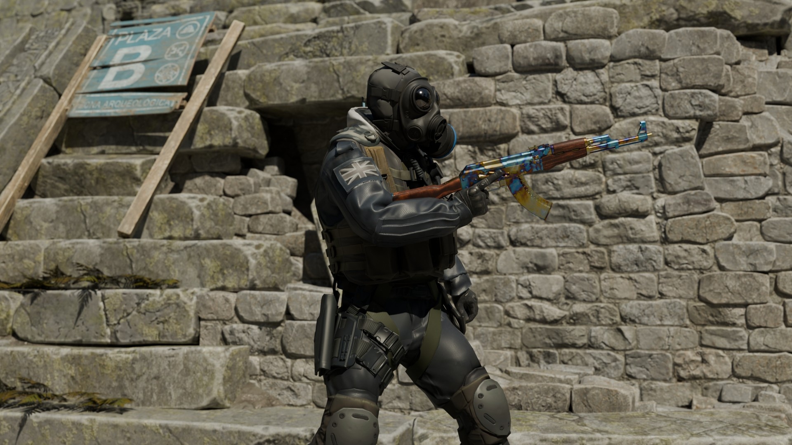
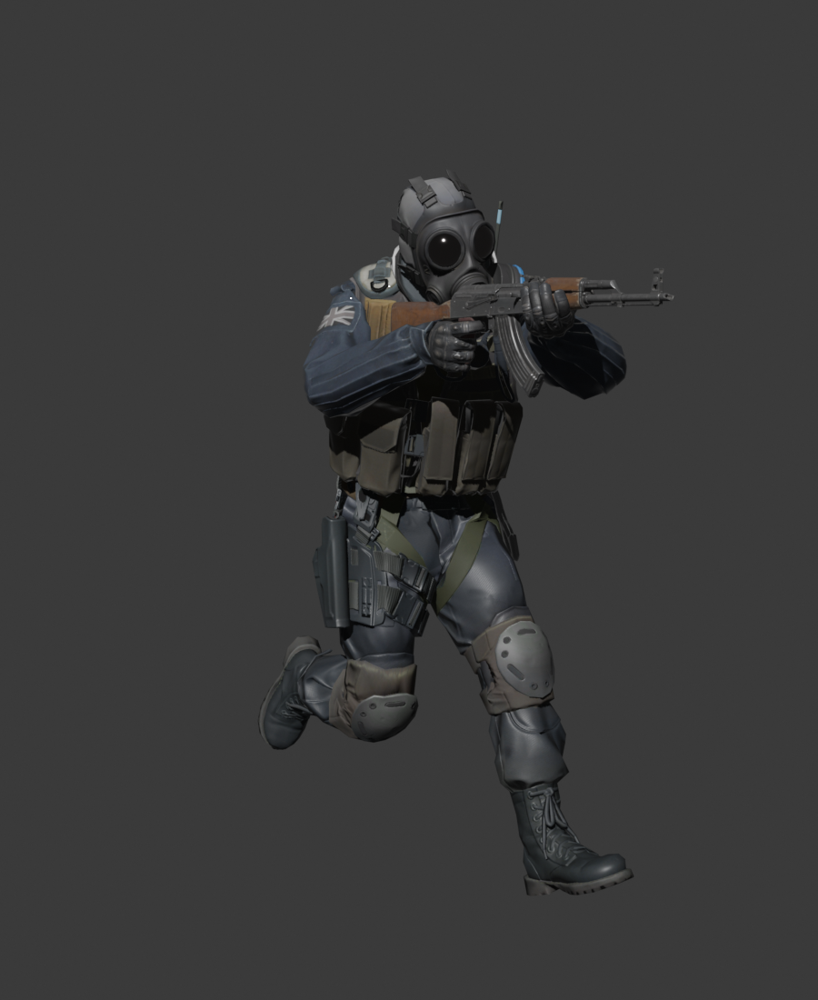
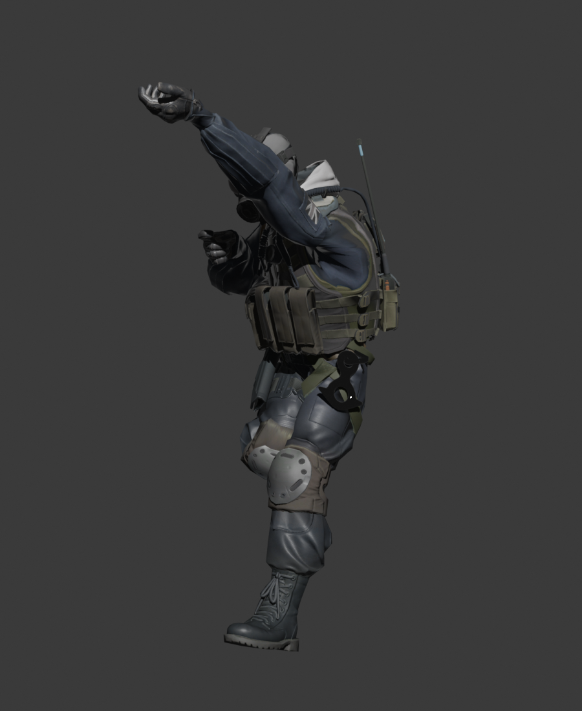

# CS2 Rigs

**Counter-Strike 2 agents, weapons, finishes and maps in Blender, from your own game install.**

Import any agent with a posable rig, put a weapon in their hands with the finish
you want, play the game's own animation clips and stand them in a real map. Everything
is converted from the game files on your disk, offline.

**Current release: 0.1.0-alpha · Windows x64 · Blender 5.3.**

> **Alpha.** Expect rough edges and report what breaks. CS2 Rigs only reads the
> game files on disk. It never opens, injects into or talks to the running game.
> Not affiliated with or endorsed by Valve.

[Quick start](#quick-start) · [Features](#features) · [Compatibility](#compatibility) ·
[Known issues](#known-issues) · [Support](#support) · [Credits](#credits)

## Quick start

1. Download `CS2_Rigs_<version>_Windows_x64.zip` from [Releases](https://github.com/cravvnn/CS2-Rigs/releases). Don't unzip it.
2. Drag the zip into Blender, or use **Edit > Preferences > Get Extensions > Install from Disk**.
3. In the 3D View press **N** and open the **CS2 Rigs** tab. Press **Download Converter** (about 65 MB, once). Blender's
   online access must be allowed under **Preferences > System**.
4. Press **Refresh**. The first time it reads the game's catalogue and finishes, which takes about half a minute.
5. Choose an agent and press **Import Agent**, then **Hold Weapon**, **Apply Finish**, **Load Clip** and **Add Controls**.

The game is found through Steam. If it is somewhere unusual, set **Game Folder** in the add-on preferences.

| First time | About |
| --- | --- |
| Download Converter | 65 MB, once |
| Refresh | about 30 s, then instant |
| Import an agent, hold a weapon or load a clip | a few seconds each, then from the cache |
| Apply a finish | about 10 s, then from the cache |
| Add a map | 3 to 5 minutes and about 1 GB, then seconds |

## Features

- **Agents.** All agents with their materials, posed by the game's skeleton.
- **Weapons.** Every weapon and knife, held on the agent's weapon bone so it follows the clip.
- **Finishes.** Weapon, knife and glove finishes built the way the game builds them, with **Wear** and **Seed**.
- **Animation clips.** Every game clip made for agents, gameplay and menu poses, filtered to the held weapon.
- **Controls.** IK/FK arms and legs, foot roll, toe, twist bones, and weapon and hand follow switches.
- **Maps.** Game maps built once into their own file, then linked or copied into your scene.

### Agents and clips

Press **Refresh**, choose an agent and press **Import Agent**. With the agent selected,
search for a clip and press **Load Clip**.

**Hold Weapon** puts the chosen weapon on the agent's weapon bone, so it follows
the clip. A clip made for the held weapon also moves its parts: slides, bolts,
magazines and knife blades. The clip list then shows only clips made for that kind of weapon: the
weapon's own clips first (a karambit's own draw), then the default ones it does
not replace, then the shared deaths, flinches and jumps. A rifle clip leaves a
knife floating where the rifle would be. Untick **Only Clips for the Held Weapon**
to see every clip, including the first-person, chicken and egg clips, which are
made for other skeletons and do not play on an agent.

Some clips only hold the difference from another pose and the game plays them on
top of one. For those the game's own full version is loaded instead.

**Build Clip Previews** loads every agent clip once in the background, checks it
and saves a small stick-figure preview of it. It takes about ten minutes.

**Browse Clips** opens every clip in the game by category, including the menu
poses, with a search field. Point at a clip to see its skeleton play; click it to
load it. Clips made for the first-person arms, the chicken and the egg are listed
greyed out, since they do not fit an agent. Press Esc or right-click to close it.

Importing an agent sets a scene still on Blender's default 24 fps to 30 fps, the
rate the game clips are authored at.

### Finishes

With a weapon held, choose a **Finish**, set **Wear** and **Seed**, and press
**Apply Finish**. The finish is built from the weapon's own textures, the
finish's pattern and colours and the game's wear and grime textures, so it wears
like it does in the game. The result is kept in the cache and packed into the .blend.

- **Wear** runs from 0 (factory new) to 1 (battle-scarred) and is kept inside
  the range the finish allows.
- **Seed** moves the pattern, wear and grime around using the same random
  sequence as the game, so pattern seeds (such as Case Hardened or Fade) match.
- Older finishes are laid out for the weapon's previous model, so applying one
  switches the weapon to that body.

1,384 of the game's 1,479 weapon and knife finishes can be applied; see
[Known issues](#known-issues) for render-time effects that are not reproduced.

### Gloves

With an agent selected, choose **Gloves** in the Agent box (for example Sport Gloves |
Vice or Driver Gloves | King Snake), set **Wear** and **Seed** and press **Apply
Gloves**. The agent's default gloves are hidden and the glove model goes on its
skeleton, so the hands follow every clip. **Remove Gloves** brings the defaults back.
The finish is built once per hand, so left and right differ the way they do in the game.

The finish is built from the game's `csgo_customglove` shader inputs for both
generations of glove finishes, including detail and damage normals, wear and
left/right pattern flipping. All 94 glove finishes can be applied.

### Controls

**Add Controls** adds, in Pose Mode:

- hand and foot IK controls with elbow and knee poles. Each limb has a 0 to 1
  switch: at 0 the game clip drives it, at 1 the control does. The **IK** and
  **FK** buttons switch a limb without moving it.
- a foot roll wheel behind each heel (turn it one way to rock back on the heel,
  the other to lift the heel off the ball of the foot) and a toe control.
- **Weapon Follows Right Hand** and **Left Hand Follows Weapon**, for posing the
  weapon by hand instead of from a clip.
- twist bones that follow the wrist and shoulder. The game turns these itself and
  its clips do not animate them, so without the controls forearms pinch when the
  hand turns.

Only the controls that currently drive a limb are shown. **Remove Controls** takes
them off again and leaves the agent as imported.

### Maps

Choose a map and press **Add Map**. The first time, the map is converted and built
into its own .blend in the cache, which takes a few minutes and about 1 GB per
map; Blender stays usable meanwhile. After that it is added in seconds. With
**Link** ticked the scene links to that file and stays small; unticked, the map is
copied into the scene.

Maps come with the game's sun but no baked lighting, so a scene without a world
gets a plain sky for fill light. Names ending in `_vanity` are the small scenes
the game shows behind its menus.

### Cache and log

Converted files live in `%LOCALAPPDATA%\cs2-rigs\cache`, in one folder per game
version and converter build. A game update starts a new folder; the add-on
preferences have buttons to clear old ones or everything. Converting everything
takes about 6 GB.

Each step is written to `cs2-rigs.log`, next to the cache by default. **Cache
Folder** and **Log Folder** in the preferences move them anywhere else, and **Open
Log Folder** shows the log.

## Compatibility

- Blender 5.3 or newer, Windows x64.
- Counter-Strike 2 installed through Steam. A game update can change the game
  files before the converter catches up; if imports start failing after one, report it.
- Source2Viewer-CLI 21.1 is pinned and checked against its published SHA-256 when
  downloaded. To use your own copy, set its path in the add-on preferences or the
  `CS2RIG_S2V_CLI` environment variable.

**Sharing .blend files.** Applied finishes are packed into the .blend, and a map
that is copied in (Link unticked) is stored in it. Sending such a file to someone
passes on Valve's assets with it; share renders, or files with linked maps and no finish.

## Known issues

This is an alpha. Not done yet:

- **Stickers.**
- **Glove finishes:** the anisotropic gloss of a few newer silk finishes is not reproduced,
  and Blender's cloth sheen is a little softer than the game's.
- **Render-time effects** such as pearlescence, glitter and iridescence.
- **Dual Berettas:** the left pistol does not follow the clip.
- **Weapon parts in clips** move only in clips made for the held weapon: a butterfly
  knife spins open in its own draw and an AK-47's magazine drops in its own reload, but
  a clip made for another weapon leaves the parts still. The parts have no controls.
- **Maps** have no baked lighting and cannot be cropped to an area yet.
- **Controls:** no torso or hip controls; twist bone weights are estimates.
- **Third person only;** first-person arms are not set up.
- **Long paths:** Blender cannot open files whose path is over 259 characters. With a
  long Windows user name or a deep **Cache Folder** some conversions fail with an error
  saying so; choose a short Cache Folder such as `C:\cs2-rigs`.

## Support

Contact **@Cravvnn on Discord**, or [report an issue](https://github.com/cravvnn/CS2-Rigs/issues/new/choose).
Include the CS2 Rigs version, what you chose and pressed, and `cs2-rigs.log`
(**Edit > Preferences > Add-ons > CS2 Rigs > Open Log Folder**).

The log writes your user folder as `~`, but it lists the agents, weapons and maps
you used; look it over before posting it publicly.

## Development

`cs2_rigs/core` has no Blender imports and is covered by `tests/` (which need
numpy for the compositor tests):

    .venv\Scripts\python -m pytest -q tests

`tools/smoke_blender.py` runs the whole path in a real Blender and renders a frame:

    blender --background --factory-startup --python tools/smoke_blender.py -- <out_dir>

`tools/rig_check.py`, `tools/weapon_check.py`, `tools/skin_check.py` and
`tools/map_check.py` run the same way and check the controls, weapon attachment,
finishes and maps. `tools/reopen_check.py` saves and reopens a file with a finish on.
`tools/glove_check.py` puts glove finishes on a CT and a T agent and renders each hand, and
`tools/glove_sweep.py` reads every glove finish and reports which apply.
`tools/panel_check.py` draws the panel without a window, to
catch a wrong icon, property or operator name. `tools/sweep.py` imports every
agent and holds every weapon, and `tools/finish_sweep.py` reads every finish
of every weapon and applies one to each; both write a report of what fails.

Build the add-on zip with Blender:

    blender --command extension build --source-dir cs2_rigs --output-dir dist

## Credits

- Inspired by [deadlockrigs](https://github.com/Sirsyorrz/deadlockrigs).
- [Source 2 Viewer](https://github.com/ValveResourceFormat/ValveResourceFormat) (MIT), whose command-line converter reads the game files.
- [Valve](https://www.valvesoftware.com/), for Counter-Strike 2 and Source 2. Game assets are not included and remain Valve's.

## Licence

MIT. See [LICENSE](LICENSE).
