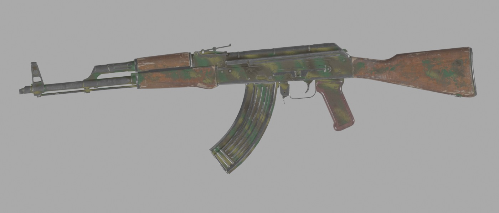

# CS2 Rigs

A Blender 5.3 add-on that brings Counter-Strike 2 agents and their game animation
clips into Blender, converted from your own installed game. It works offline and
never touches the running game.

Status: early. It imports an agent with materials, plays third-person game clips
on it, puts a weapon in its hands with a finish on it, adds animation controls and
brings in game maps.

## Requirements

- Blender 5.3, Windows x64
- Counter-Strike 2 installed through Steam
- Source2Viewer-CLI from [Source 2 Viewer](https://github.com/ValveResourceFormat/ValveResourceFormat) (MIT).
  **Download Converter** in the panel fetches the pinned release (about 65 MB) and
  checks it against a known SHA-256. To use your own copy, set its path in the
  add-on preferences or the `CS2RIG_S2V_CLI` environment variable.

## Use

Open the 3D View sidebar (N) > CS2 Rigs. Press **Refresh**, choose an agent and
press **Import Agent**. With the agent selected, search for a clip and press
**Load Clip**. The first import of each agent or clip takes about ten seconds while
it is converted; later loads come from the cache in `%LOCALAPPDATA%\cs2-rigs`.

**Hold Weapon** puts the chosen weapon on the agent's weapon bone, so it follows
the clip. The clip list then shows only clips made for that kind of weapon; a
rifle clip leaves a knife floating where the rifle would be. Untick **Only Clips
for the Held Weapon** to see every clip.

Importing an agent sets a scene still on Blender's default 24 fps to 30 fps, the
rate the game clips are authored at.

### Finishes

With a weapon held, choose a **Finish**, set **Wear** and **Seed**, and press
**Apply Finish**. The finish is built the way the game builds it, from the
weapon's own textures, the finish's pattern and colours and the game's wear and
grime textures, so it wears like it does in the game. The first time takes a
few seconds; the result is kept in the cache and packed into the .blend.

- **Wear** runs from 0 (factory new) to 1 (battle-scarred) and is kept inside
  the range the finish allows.
- **Seed** moves the pattern, wear and grime around. A seed gives the same
  result every time here, but not the placement that seed has in the game.
- Older finishes are laid out for the weapon's previous model, so applying one
  switches the weapon to that body.

All weapon and knife finishes can be applied. A few parts are left out and
named when you apply a finish that has them: overlays, halftone and masked
spray, case hardening and patina ageing, which some of the newest finishes use. Effects the
game adds while rendering (pearlescence, glitter, iridescence), stickers and
glove finishes are not done.

### Controls

**Add Controls** adds, in Pose Mode:

- hand and foot IK controls with elbow and knee poles. Each limb has a 0 to 1
  switch: at 0 the game clip drives it, at 1 the control does. The **IK** and
  **FK** buttons switch a limb without moving it.
- a foot roll wheel behind each heel (turn it one way to rock back on the heel,
  the other to lift the heel off the ball of the foot) and a toe control.
- **Weapon Follows Right Hand** and **Left Hand Follows Weapon**, for posing the
  weapon by hand instead of from a clip.
- twist bones that follow the wrist and shoulder. The game turns these itself and
  its clips do not animate them, so without the controls forearms pinch when the
  hand turns.

Only the controls that currently drive a limb are shown. **Remove Controls** takes
them off again and leaves the agent as imported.

### Maps

Choose a map and press **Add Map**. The first time, the map is converted and built
into its own .blend in the cache, which takes a few minutes and about 1 GB per
map; Blender stays usable meanwhile. After that it is added in seconds. With
**Link** ticked the scene links to that file and stays small; unticked, the map is
copied into the scene.

Maps come with the game's sun but no baked lighting, so a scene without a world
gets a plain sky for fill light. Names ending in `_vanity` are the small scenes
the game shows behind its menus.

### Cache

Converted files live in `%LOCALAPPDATA%\cs2-rigs\cache`, in one folder per game
version and converter build. A game update starts a new folder; the add-on
preferences have buttons to clear old ones or everything.
## Development

`cs2_rigs/core` has no Blender imports and is covered by `tests/` (which need
numpy for the compositor tests):

    .venv\Scripts\python -m pytest -q tests

`tools/smoke_blender.py` runs the whole path in a real Blender and renders a frame:

    blender --background --factory-startup --python tools/smoke_blender.py -- <out_dir>

`tools/rig_check.py`, `tools/weapon_check.py`, `tools/skin_check.py` and
`tools/map_check.py` run the same way and check the controls, weapon attachment,
finishes and maps. `tools/reopen_check.py` saves and reopens a file with a finish on.
`tools/panel_check.py` draws the panel without a window, to
catch a wrong icon, property or operator name. `tools/sweep.py` imports every
agent and holds every weapon, and `tools/finish_sweep.py` reads every finish
of every weapon and applies one to each; both write a report of what fails.
Converting everything fills about 6 GB of cache.

## Licence

MIT. Game assets are not included and remain Valve's.
